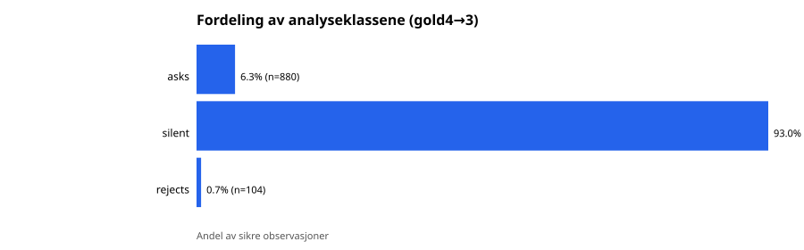
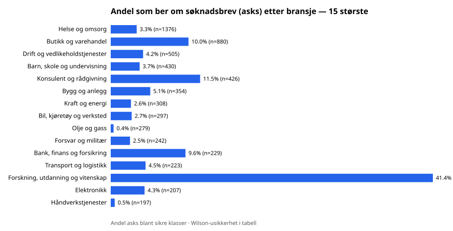
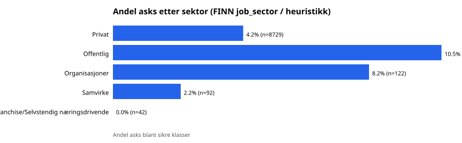
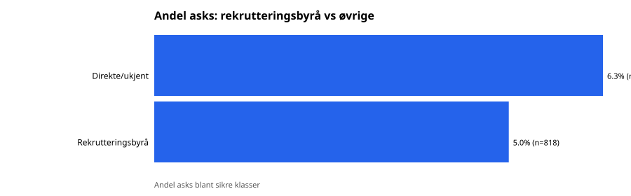

# Resultatoversikt: Søknadsbrev i norske stillingsannonser på FINN

**Dokumentrolle:** Kompakt resultatoversikt (ikke full metode-/valideringsrapport).  
**Full forskningsrapport:** [`reports/forskningsrapport.md`](forskningsrapport.md) — bruk den for nevere, dekning, validering og aktive populasjonstall.  
**Datasett her:** `data/observations.v2.jsonl` (v1 fryst + coverage gap-fill; inkl. 228 churn-rader utenfor live union).  
**Analyseklasser:** regelbasert gold4 på lagret annonsetekst (`required`/`optional`/`explicit_reject`/`no_info`/`uncertain`), kollapset til asks/silent/rejects for treveisandeler. Usikre er ekskludert fra asks-nevner.  
**Kjøring:** `python3 scripts/run_research_analysis.py`

## 1. Formål

Undersøke hvor utbredt det er å etterspørre søknadsbrev i FINN Jobb-annonser, hvordan praksisen varierer, og om dataene støtter påstanden om at rekrutteringsbransjen er i ferd med å avskaffe søknadsbrevet.

## 2. Metode

### 2.1 Populasjon og dekning

- Enhet: unik FINN-annonse (`group_count`), ikke stillingsposisjon (`match_count`).
- v2 dekker hele den enumertede live-unionen `industry ∪ occupation` ved gap-fill (se `reports/dekning.md`).
- Fryst v1 beholdes uendret; gap-fill ligger i `data/incremental/`.

### 2.2 Klassifisering

1. **Produksjonsklassifisering** (`originalClassification`): mønsterbasert ved innsamling.
2. **Analyseklassifisering (gold4):** utvidede synonymer + reject-først, inkl. *søknadstekst* / *personlig søknad*; usikre motivasjonsfraser holdes separate.
3. Valideringsutvalg (frø 14) på v1 dokumenterer produksjonsfeilrater; se `reports/01-02-datagrunnlag-og-validering.md`.

### 2.3 Variabler

| Variabel | Kilde | Begrensning |
|---|---|---|
| Bransje | First-seen industry / «Uten bransjetagg» | Mange annonser mangler bransjetagg |
| Yrke | FINN occupation-filtre | Multi-tag; primary = første i enum |
| Sektor | FINN `job_sector` (+ selskapsheuristikk) | Heuristikk mer usikker |
| Rekrutteringsbyrå | Selskapsmønstre + FINN «Bemanningsbyrå» | Underdeteksjon mulig |
| Stillingsnivå | Tittelord (leder/junior/senior) | Grovt, tittelbasert |
| Erfaring/utdanning | FINN-filtre | Mangler for mange annonser |

### 2.4 Statistikk

- Andeler med Wilson 95 % CI.
- Effektmål: risikodifferanse (asks-andel) mellom grupper.
- Logistisk regresjon (L2) for asks ~ byrå + offentlig + tittelnivå blant rader med kjent Offentlig/Privat.

## 3. Resultater

### 3.1 Samlet utbredelse

| Størrelse | Verdi |
|---|---:|
| Observasjoner v2 | 14114 |
| Analyserbare | 14113 |
| Sikre (ikke uncertain) | 14061 |
| Asks-andel (sikre) | **6.26 %** (Wilson 5.87–6.67 %) |
| Silent-andel (sikre) | 93.00 % |
| Rejects-andel (sikre) | 0.74 % (Wilson 0.61–0.90 %) |

Gold4-tellinger: `{"no_info": 13077, "explicit_reject": 104, "required": 880, "uncertain": 52}`.



**Observert:** De fleste annonser nevner ikke søknadsbrev. Eksplisitt avvisning er sjelden, men ikke null.  
**Slutning:** Innen dette FINN-tverrsnittet er aktiv etterspørsel etter søknadsbrev en **minoritetspraksis** (~6.3 %).  
**Vet ikke:** Om praksisen er i endring over tid (kun ett tverrsnitt).

### 3.2 Variasjon etter bransje

| Gruppe | n | asks % | 95 % Wilson | rejects % |
|---|---:|---:|---|---:|
| Helse og omsorg | 1376 | 3.3 % | 2.5–4.4 % | 0.07 % |
| Butikk og varehandel | 880 | 10.0 % | 8.2–12.2 % | 0.80 % |
| Drift og vedlikeholdstjenester | 505 | 4.2 % | 2.7–6.3 % | 2.97 % |
| Barn, skole og undervisning | 430 | 3.7 % | 2.3–6.0 % | 0.00 % |
| Konsulent og rådgivning | 426 | 11.5 % | 8.8–14.9 % | 1.41 % |
| Bygg og anlegg | 354 | 5.1 % | 3.2–7.9 % | 1.98 % |
| Kraft og energi | 308 | 2.6 % | 1.3–5.0 % | 0.97 % |
| Bil, kjøretøy og verksted | 297 | 2.7 % | 1.4–5.2 % | 0.00 % |
| Olje og gass | 279 | 0.4 % | 0.1–2.0 % | 1.08 % |
| Forsvar og militær | 242 | 2.5 % | 1.1–5.3 % | 2.89 % |
| Bank, finans og forsikring | 229 | 9.6 % | 6.4–14.1 % | 4.37 % |
| Transport og logistikk | 223 | 4.5 % | 2.5–8.1 % | 0.45 % |
| Forskning, utdanning og vitenskap | 210 | 41.4 % | 35.0–48.2 % | 0.48 % |
| Elektronikk | 207 | 4.3 % | 2.3–8.1 % | 0.00 % |
| Håndverkstjenester | 197 | 0.5 % | 0.1–2.8 % | 0.51 % |
| Offentlig administrasjon | 163 | 14.1 % | 9.6–20.3 % | 0.00 % |
| Eiendom | 148 | 2.0 % | 0.7–5.8 % | 13.51 % |
| Industri og produksjon | 147 | 2.0 % | 0.7–5.8 % | 0.68 % |
| Matvareproduksjon og -industri | 144 | 5.6 % | 2.8–10.6 % | 0.69 % |
| Restaurant, mat og uteliv | 123 | 1.6 % | 0.4–5.7 % | 0.00 % |
| Bil- og bildelproduksjon | 115 | 0.0 % | 0.0–3.2 % | 0.00 % |
| HR, organisasjonsutvikling og rekruttering | 112 | 4.5 % | 1.9–10.0 % | 2.68 % |
| Hotell og overnatting | 107 | 0.0 % | 0.0–3.5 % | 0.00 % |
| Grossisthandel import/eksport | 100 | 5.0 % | 2.1–11.2 % | 0.00 % |
| IT | 98 | 16.3 % | 10.3–24.9 % | 0.00 % |



### 3.3 Yrke (occupation)

| Gruppe | n | asks % | 95 % Wilson | rejects % |
|---|---:|---:|---|---:|
| Helsepersonell | 2383 | 3.7 % | 3.0–4.5 % | 0.08 % |
| Håndverker | 1003 | 1.9 % | 1.2–2.9 % | 1.89 % |
| Ingeniør | 953 | 6.3 % | 4.9–8.0 % | 0.73 % |
| Undervisning og pedagogikk | 809 | 6.1 % | 4.6–7.9 % | 0.12 % |
| Mat og servering | 694 | 1.9 % | 1.1–3.2 % | 0.00 % |
| Ledelse | 563 | 6.9 % | 5.1–9.3 % | 0.89 % |
| Barnehage | 467 | 2.1 % | 1.2–3.9 % | 0.43 % |
| Kundeservice | 462 | 8.2 % | 6.0–11.1 % | 1.52 % |
| Salg | 430 | 5.1 % | 3.4–7.6 % | 0.70 % |
| Kontor og administrasjon | 414 | 10.6 % | 8.0–14.0 % | 0.97 % |
| IT utvikling | 399 | 12.3 % | 9.4–15.9 % | 1.50 % |
| Sykepleier | 384 | 2.6 % | 1.4–4.7 % | 0.00 % |
| Lege | 324 | 1.5 % | 0.7–3.6 % | 0.00 % |
| Butikkansatt | 280 | 10.4 % | 7.3–14.5 % | 0.00 % |
| Ukjent | 273 | 5.1 % | 3.1–8.4 % | 0.73 % |
| Omsorg og sosialt arbeid | 261 | 1.9 % | 0.8–4.4 % | 0.00 % |
| Logistikk og lager | 254 | 4.3 % | 2.4–7.6 % | 1.57 % |
| Økonomi og regnskap | 221 | 4.1 % | 2.2–7.6 % | 0.90 % |
| Forskning/Stipendiat/Postdoktor | 192 | 62.0 % | 54.9–68.5 % | 0.00 % |
| Rådgivning | 185 | 11.3 % | 7.5–16.7 % | 1.62 % |

### 3.4 Sektor

| Gruppe | n | asks % | 95 % Wilson | rejects % |
|---|---:|---:|---|---:|
| Privat | 8729 | 4.2 % | 3.8–4.6 % | 0.62 % |
| Offentlig | 4630 | 10.5 % | 9.7–11.4 % | 1.04 % |
| Organisasjoner | 122 | 8.2 % | 4.5–14.4 % | 0.00 % |
| Samvirke | 92 | 2.2 % | 0.6–7.6 % | 0.00 % |
| Franchise/Selvstendig næringsdrivende | 42 | 0.0 % | 0.0–8.4 % | 0.00 % |



### 3.5 Rekrutteringsbyrå vs øvrige

| Gruppe | n | asks % | 95 % Wilson | rejects % |
|---|---:|---:|---|---:|
| Direkte/ukjent | 13243 | 6.3 % | 5.9–6.8 % | 0.79 % |
| Rekrutteringsbyrå | 818 | 5.0 % | 3.7–6.7 % | 0.00 % |



### 3.6 Stillingsnivå (tittel), erfaring og utdanning

**Tittelnivå**

| Gruppe | n | asks % | 95 % Wilson | rejects % |
|---|---:|---:|---|---:|
| annet/ukjent | 12800 | 6.1 % | 5.7–6.6 % | 0.73 % |
| leder | 806 | 5.1 % | 3.8–6.8 % | 0.74 % |
| senior | 342 | 5.6 % | 3.6–8.5 % | 0.88 % |
| junior | 113 | 30.1 % | 22.4–39.1 % | 1.77 % |

**FINN arbeidserfaring** (kun annonser med tag)

| Gruppe | n | asks % | 95 % Wilson | rejects % |
|---|---:|---:|---|---:|
| Erfaren | 4607 | 6.1 % | 5.4–6.8 % | 1.19 % |
| Junior | 1827 | 7.3 % | 6.2–8.6 % | 1.26 % |
| Ingen erfaring | 1485 | 5.5 % | 4.5–6.8 % | 1.08 % |
| Leder | 74 | 4.0 % | 1.4–11.2 % | 0.00 % |

**FINN utdanning** (kun annonser med tag)

| Gruppe | n | asks % | 95 % Wilson | rejects % |
|---|---:|---:|---|---:|
| Univ. lavere | 2193 | 7.2 % | 6.2–8.4 % | 1.37 % |
| Ingen utdanning | 2041 | 4.9 % | 4.0–5.9 % | 0.64 % |
| Univ. høyere | 1657 | 9.7 % | 8.4–11.2 % | 1.63 % |
| Fagbrev | 1461 | 3.0 % | 2.2–4.0 % | 1.64 % |
| Videregående (studieforberedende) | 95 | 5.3 % | 2.3–11.7 % | 1.05 % |
| Doktorgrad | 73 | 42.5 % | 31.8–53.9 % | 0.00 % |
| Videregående (yrkesfaglig) | 69 | 5.8 % | 2.3–14.0 % | 0.00 % |
| Fagskole | 48 | 0.0 % | 0.0–7.4 % | 0.00 % |

### 3.7 Multivariabel logit

n = 13359 (Offentlig/Privat med sikker klasse).

| Ledd | Koeff. | SE | z | OR |
|---|---:|---:|---:|---:|
| intercept | -3.209 | 0.0589 | -54.437 | — |
| agency | 0.2181 | 0.1678 | 1.3 | 1.244 |
| public_sector | 1.0475 | 0.0747 | 14.026 | 2.85 |
| title_leder | 0.0545 | 0.1646 | 0.331 | 1.056 |
| title_junior | 2.0231 | 0.2123 | 9.531 | 7.562 |

L2-regularisert logit uten sklearn; SE via diagonal Hessian-approx. Tolk som beskrivende multivariable assosiasjoner, ikke kausale effekter.


## 4. Hypoteser

### A. Rekrutteringsbyråer etterspør søknadsbrev sjeldnere

**Kan undersøkes med eksisterende data:** ja (med underdeteksjonsforbehold).

| Gruppe | n | asks % | 95 % Wilson |
|---|---:|---:|---|
| Rekrutteringsbyrå | 818 | 5.01 % | 3.72–6.73 |
| Direkte/ukjent | 13243 | 6.34 % | 5.93–6.76 |

Risikodifferanse (byrå − øvrige): **-0.0133**.  
Rå asks-andel er litt lavere hos byrå (RD=-0.0133), men Wilson-intervallene overlapper (ja). Multivariabel logit (kontroll for sektor/tittel) viser ikke et klart negativt byrå-estimat. Samlet: svak/usikker støtte til A; ikke robust evidens for at byråer har avskaffet søknadsbrevet.

### B. Sjeldnere søknadsbrev i yrker med stor forventet søkertilgang

**Kan ikke testes forsvarlig med eksisterende data.**  
Antall annonser i et yrke er **ikke** brukt som mål på søkertilgang. Det kreves eksterne indikatorer eller direkte søknadsvolum.

### C. Silent ≠ eksplisitt reject

**Kan undersøkes:** ja.

- Silent: 13077 (92.66 %)
- Rejects: 104 (0.74 %)
- Forhold silent/rejects ≈ 125.7

Silent dominerer tallmessig; rejects er sjeldne men qualitatively distinct. Å slå dem sammen som «ikke ber om søknadsbrev» skjuler en annen praksis (aktiv avvikling vs. stilltiende utelatelse).

## 5. Begrensninger

1. Tverrsnitt — ingen tidstrend, derfor ingen direkte evidens for «avskaffelse over tid».
2. Byrådefinisjon basert på navn/filter — residual feilklassifisering.
3. Bransje mangler for gap-fill-annonser uten tag.
4. Gold4 er regelbasert census, ikke full manuell kodingsstudie (men informert av v1-validering).
5. Logit er assosiativ, ikke kausal; begrenset kovariatsett.
6. FINN-katalog endres kontinuerlig (churn).

## 6. Konklusjoner

1. **Observert:** Søknadsbrev etterspørres i et mindretall av annonsene; de fleste er silent; eksplisitt nei er sjeldent.
2. **Observert:** Praksisen varierer etter bransje/yrke/sektor; se tabeller.
3. **Slutning (forsiktig):** Hypotese A kan støttes eller svekkes av risikodifferansen over; se tall i §4A — ikke oversett underdeteksjon av byrå.
4. **Ikke slutning:** At rekrutteringsbransjen «er i ferd med å avskaffe» søknadsbrevet — krever tidsserie.
5. **Ikke slutning:** Hypotese B — mangler mål på søkertilgang.
6. **Slutning:** Hypotese C støttes: silent og reject er ulike praksiser og bør ikke slås sammen analytisk.

## 7. Reproduksjon og deling

```bash
cd finn-soknadsbrev
# Enrichment (FINN search API; kan ta tid; resume via checkpoint)
python3 scripts/enrich_observations.py
# Analyse, figurer, public dataset, denne rapporten
python3 scripts/run_research_analysis.py
```

| Artefakt | Innhold |
|---|---|
| `data/analysis/observations.public.jsonl` | Delbart: id, metadata, klasser — **uten** full annonsetekst |
| `data/analysis/research_results.json` | Maskinlesbare resultater |
| `data/original/observations.v1.jsonl` | Fryst original |
| `data/observations.v2.jsonl` | Fulltekst for repro (internt) |
| `reports/figures/*.svg` | Figurer |

## 8. Skille observert / slutning / ukjent

| | |
|---|---|
| **Observert** | Tellinger og andeler i v2 med oppgitte CI |
| **Slutning** | Forskjeller som er store nok og konsistente med definisjoner; C om silent≠reject |
| **Ukjent** | Tidstrender; kausal effekt av byrå; søkertilgang (B); annonser utenfor FINNs søke-API |
